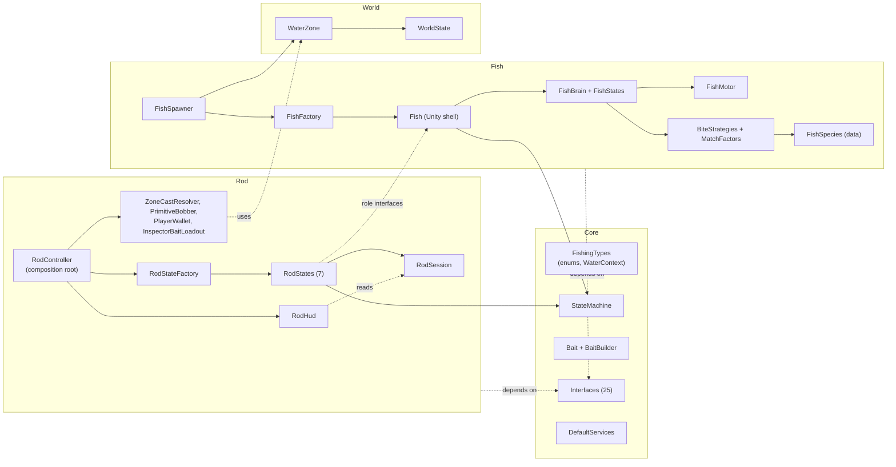
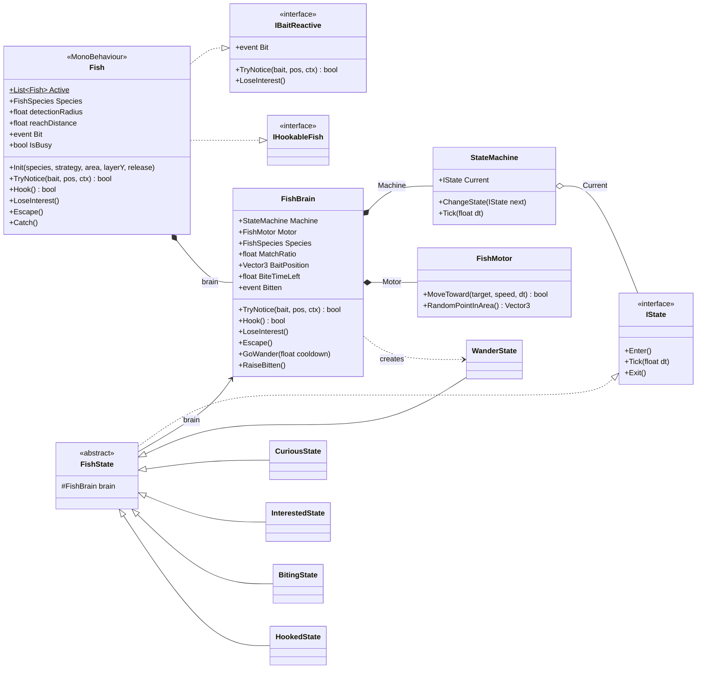
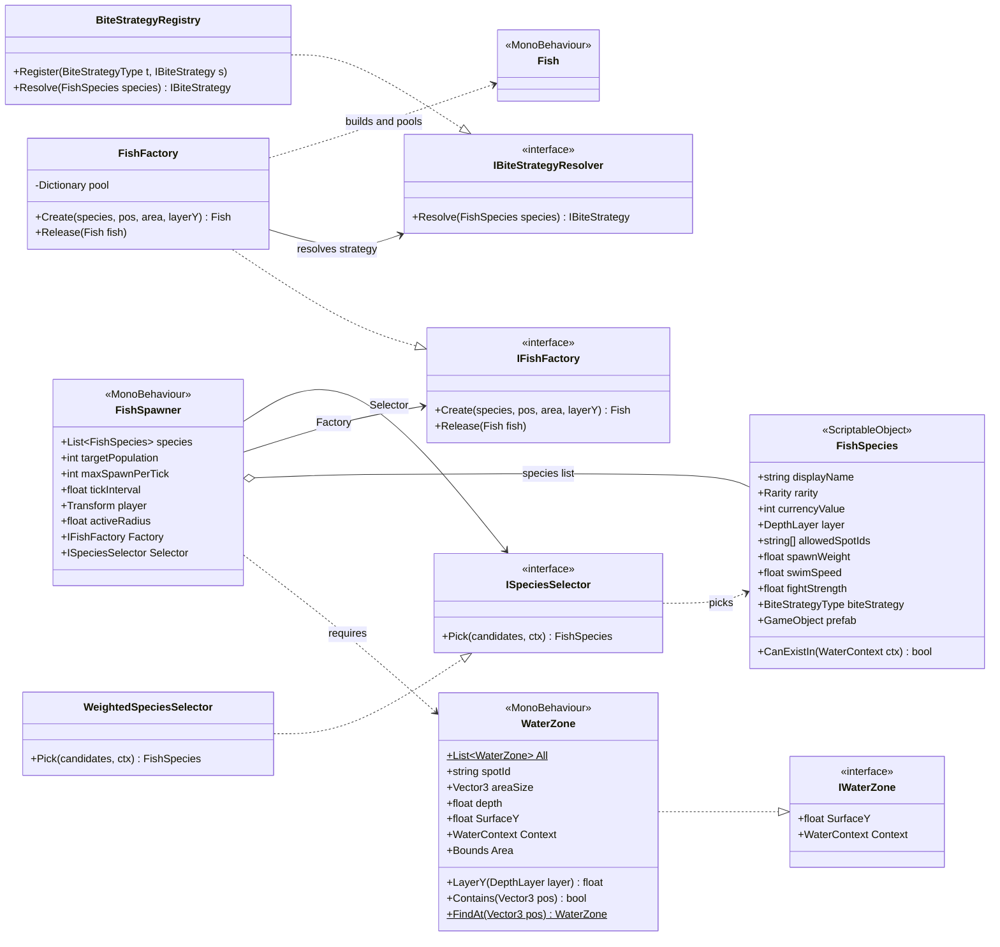
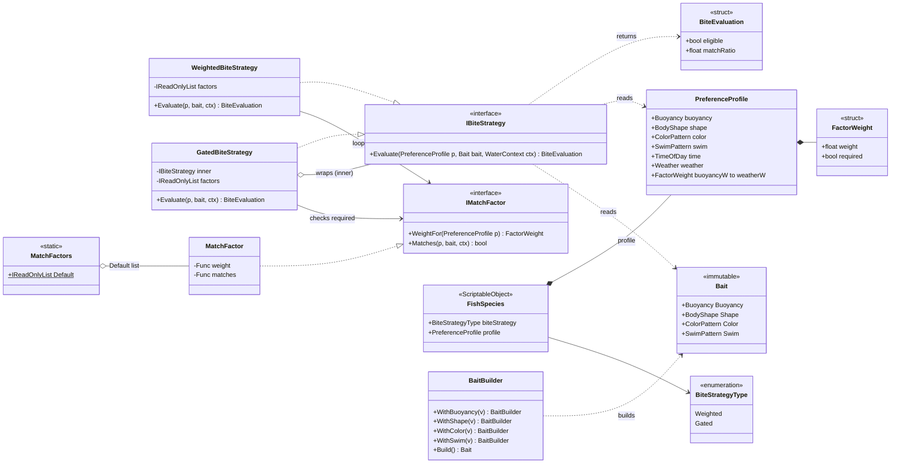
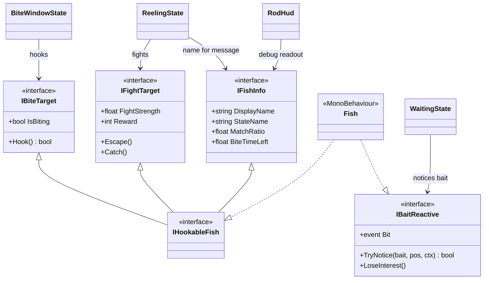
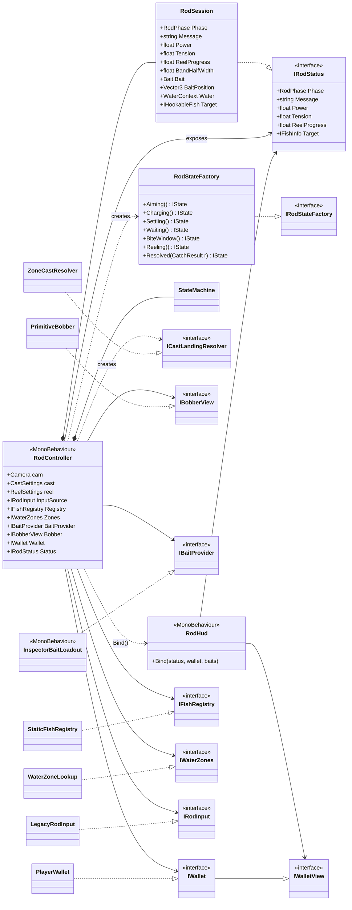
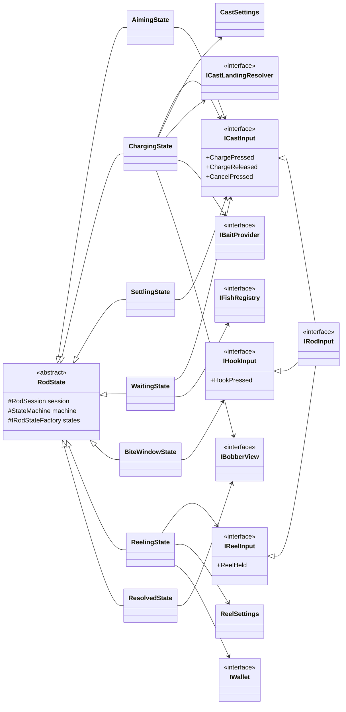
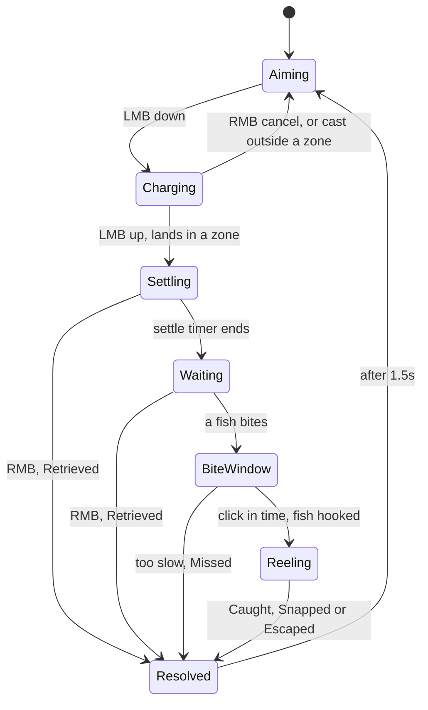
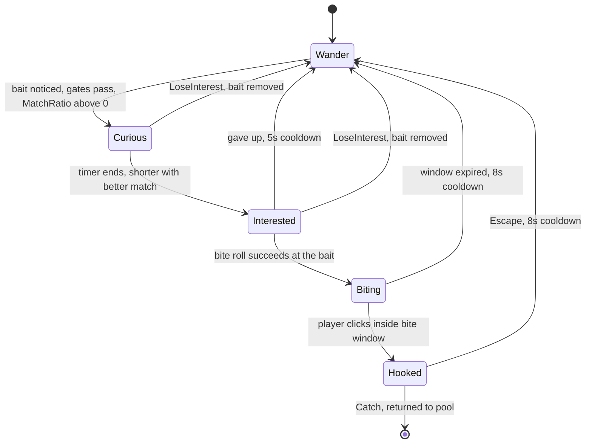

# Tidebook - UML Diagram

## 1. Module map

---

## 2. Fish behaviour (Unity shell, brain, motor, states)

---

## 3. Spawning, factory and species selection

---

## 4. Bite strategy, match factors and species data

---

## 5. Fish role interfaces (Interface Segregation)

---

## 6. Rod wiring (composition root, factory, injected services)

---

## 7. Rod states and what each one depends on (Interface Segregation)

---

## 8. Rod state flow

---

## 9. Fish state flow (one instance per spawned fish)

