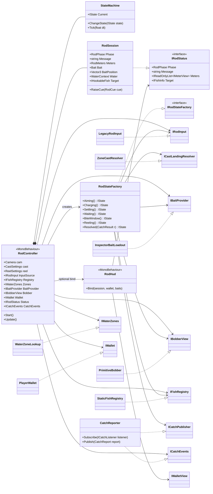
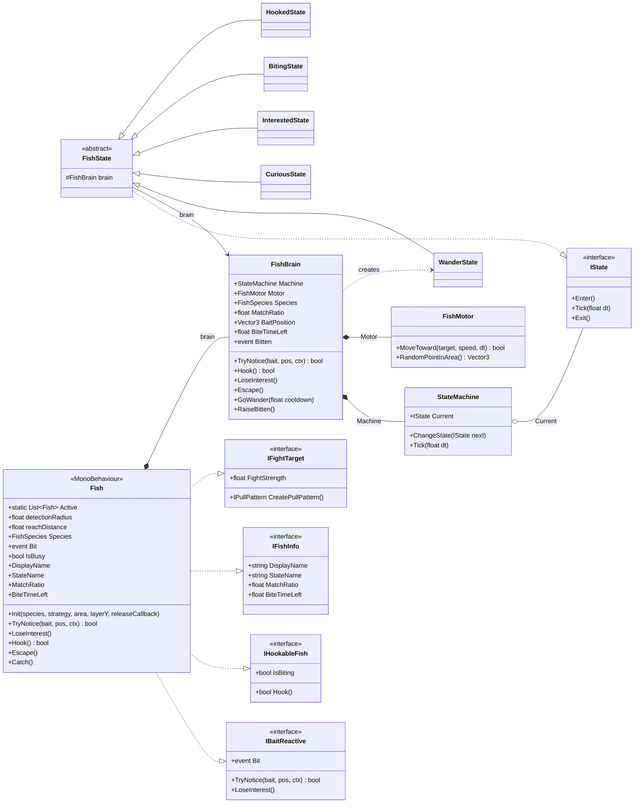
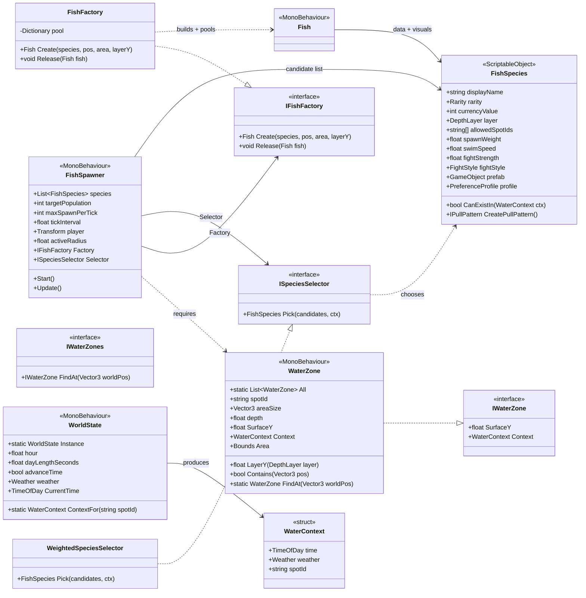
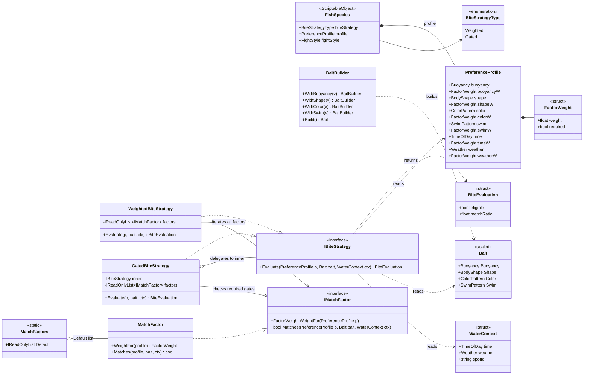
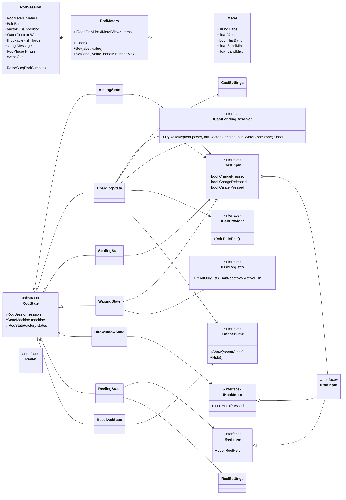
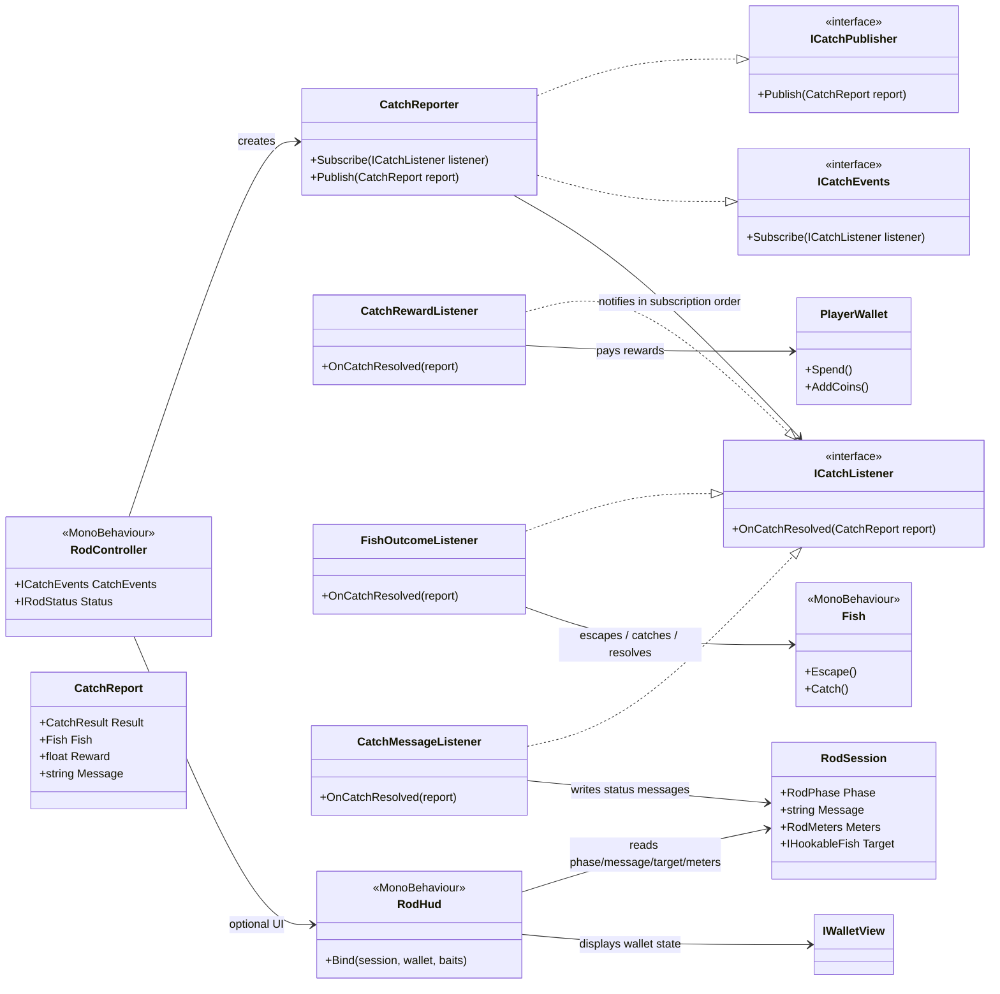
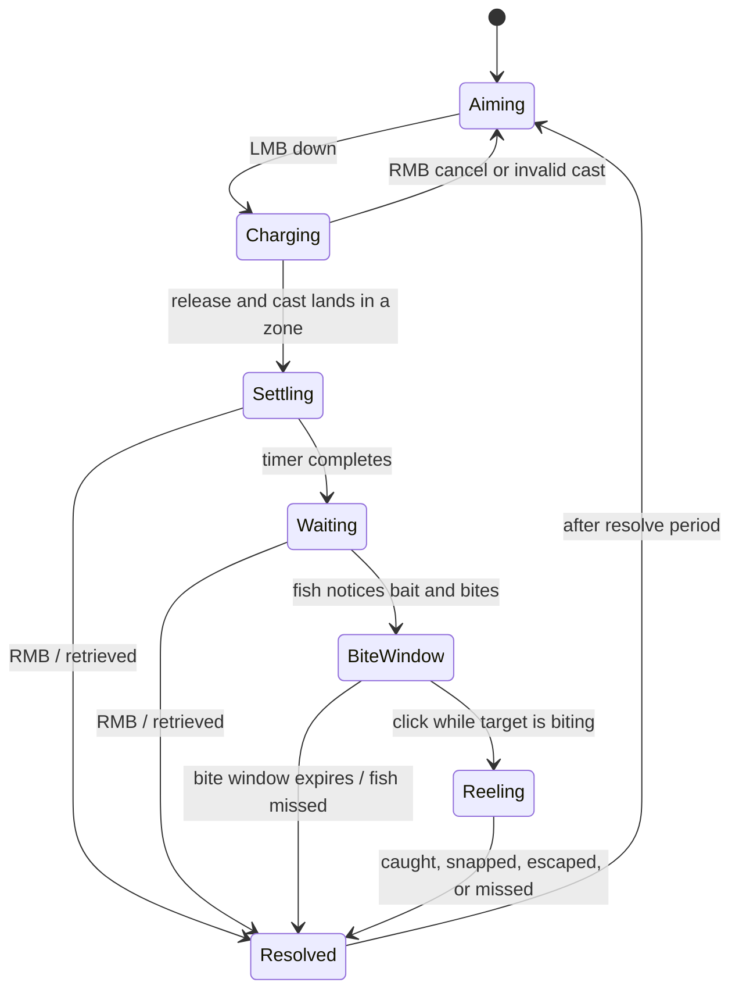
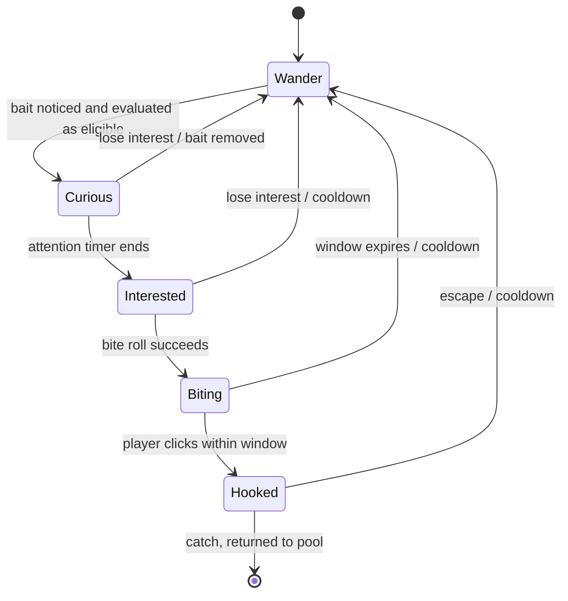

# Tidebook - UML Diagram

This document reflects the current runtime structure in the Unity project as it exists in the codebase today. It focuses on the modules that are actually wired together: world/spot data, bait matching, fish spawning and behavior, the rod state machine, and catch outcome listeners.

## 1. Runtime module map

```mermaid
flowchart LR
    subgraph World["World + local conditions"]
        WorldState["WorldState<br/>hour / weather / spot context"]
        WaterZone["WaterZone<br/>geometry + Context"]
        Lookup["WaterZoneLookup<br/>FindAt()"]
    end

    subgraph Bait["Bait + matching"]
        BaitData["Bait / BaitBuilder"]
        Pref["PreferenceProfile<br/>FactorWeight"]
        Match["MatchFactors<br/>weighted factor rules"]
        Strategies["BiteStrategyRegistry<br/>Weighted / Gated"]
    end

    subgraph Fish["Fish module"]
        FishSpawner["FishSpawner"]
        Factory["FishFactory"]
        Selector["WeightedSpeciesSelector"]
        Fish["Fish<br/>MonoBehaviour"]
        Brain["FishBrain"]
        Motor["FishMotor"]
        Species["FishSpecies<br/>ScriptableObject"]
        Styles["FightStyle<br/>IPullPattern"]
    end

    subgraph Rod["Rod module"]
        RodController["RodController"]
        Session["RodSession<br/>Phase / Message / Meters / Target"]
        FactoryState["RodStateFactory"]
        States["RodState subclasses<br/>Aiming / Charging / Waiting / BiteWindow / Reeling / Resolved"]
        Hud["RodHud"]
        Input["LegacyRodInput"]
        Bobber["PrimitiveBobber"]
        Wallet["PlayerWallet"]
        Baits["InspectorBaitLoadout"]
    end

    subgraph Catch["Outcome pipeline"]
        CatchReporter["CatchReporter<br/>observer list"]
        Listeners["CatchRewardListener<br/>FishOutcomeListener<br/>CatchMessageListener"]
    end

    WorldState --> WaterZone
    WaterZone --> Lookup
    WaterZone --> FishSpawner

    FishSpawner --> Factory
    FishSpawner --> Selector
    Factory --> Fish
    Fish --> Brain
    Brain --> Motor
    Fish --> Species
    Species --> Pref
    Species --> Styles
    Species --> Strategies
    Strategies --> Match
    Baits --> BaitData
    Fish --> BaitData

    RodController --> Session
    RodController --> FactoryState
    RodController --> Input
    RodController --> Bobber
    RodController --> Wallet
    RodController --> Baits
    AssemblyState["StateMachine"] --- RodController
    FactoryState --> States
    States --> Session
    States --> Input
    States --> Bobber
    States --> Baits
    States --> CatchReporter

    RodController --> Hud
    Hud --> Session
    Hud --> Wallet

    CatchReporter --> Listeners
    Listeners --> Wallet
    Listeners --> Session
```

---

## 2. Rod controller and state wiring



---

## 3. Fish lifecycle and gameplay behavior



---

## 4. Spawning, factory, registry, and world placement



---

## 5. Bait matching and bite evaluation



---

## 6. Rod state machine and shared cast/session data



---

## 7. Catch outcomes and UI listeners



---

## 8. Rod state flow



---

## 9. Fish state flow


