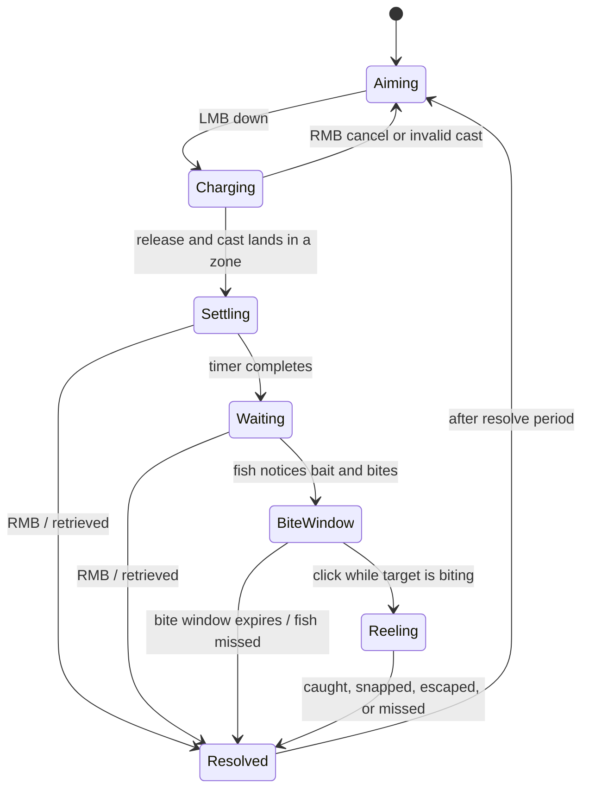
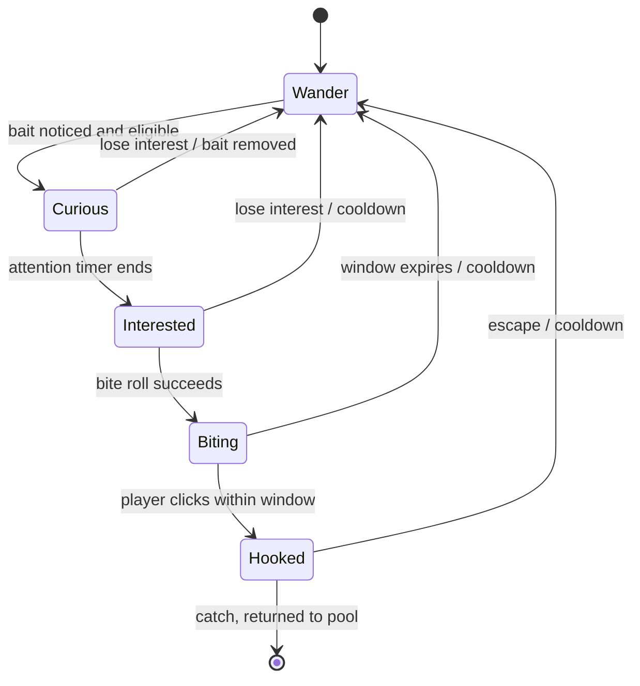

# 🎣 Tidebook

**A relaxing first-person fishing & collection game built in Unity.**

Explore a small open world, read the water, build the right bait, and catch every species to complete your Fish Index. No combat. No fail-state. Just you, a rod, and the tide.

> Game Design Document: Activity 01 · EMC208 · Lee, Cian
> 📄 [Read the full GDD](https://docs.google.com/document/d/1C36t8hB0mL4xr-5BxLe6q6ilsJLNDil4LVuTaczvZzE/edit?usp=sharing)

---

## Table of Contents

- [Overview](#overview)
- [Core Pillars](#core-pillars)
- [Gameplay Loop](#gameplay-loop)
- [Features](#features)
- [Bait-Fish Matching](#bait-fish-matching)
- [Controls](#controls)
- [Architecture](#architecture)
- [Design Patterns](#design-patterns)
- [Project Structure](#project-structure)
- [Getting Started](#getting-started)
- [Roadmap](#roadmap)
- [Documentation](#documentation)
- [Credits](#credits)
- [License](#license)

---

## Overview

Tidebook is a single-player, low-poly fishing game set in one small, continuous, walkable world. Fishing spots (a shallow bay/dock, a river, a deep lake, and a night-only cove) are distinguished by depth, water conditions, and the species that live there.

The long-term goal is to discover and catalogue every fish in the **Fish Index** (the in-game Tidebook). Catches earn currency, which is spent only on cosmetics, so strategy and execution stay consistent from the first cast to the last.

## Core Pillars

| Pillar | Description |
| --- | --- |
| **Collection-driven exploration** | The Fish Index gives every system a purpose. |
| **Strategy before execution** | Success depends on bait choice and observation, not reflexes. |
| **Low pressure** | No fail-state, no combat, no timers. Curiosity is rewarded, mistakes aren't punished. |
| **Readable systems** | Hidden calculations (fish AI, bait matching) are surfaced through ripples, shadows, and simple UI. |

## Gameplay Loop

```
Observe water → Build bait → Cast → Read fish behavior → Hook & reel → Log in Fish Index → Buy cosmetics
```

1. **Observe**: ripples on the surface hint at nearby fish.
2. **Build bait**: combine buoyancy, shape, color/pattern, and swim pattern.
3. **Cast**: aim with the crosshair, hold to charge power, release to cast.
4. **Read**: a shadow/silhouette approaches the bait as a fish becomes interested.
5. **Hook & reel**: react to the bite indicator, then win the reel-in struggle.
6. **Collect**: log the catch and spend earned currency on cosmetics.

## Features

- **Hold-and-release casting** with a limited-range crosshair and power meter
- **Bait Builder** with four freely combinable axes, available from the start
- **Fish Index (Tidebook)** with discovered fish details and locked silhouettes for undiscovered species
- **Independent fish AI**: every fish runs its own state machine simultaneously
- **Fight styles**: Steady, Burst and Rest, Escalating, and Random Bursts, defined as ScriptableObjects, with a tension-band reel-in
- **Day/night cycle and weather** (clear, rain, storm, fog) that affect which fish appear and bite
- **Cosmetic customization** for rod and reel designs/colors (no gameplay effect)
- **Procedural pixel-art UI** for fish and bait sprites
- **Low-poly stylized art** with layered feedback and ambient audio

## Bait-Fish Matching

Each species has a preference profile across up to eight factors: buoyancy, body shape, color/pattern, swim pattern, vertical water position, specific spot, day/night, and weather.

| Step | Description |
| --- | --- |
| 1. Eligibility Gate | Hard requirements (e.g. night only, specific spot) must pass before scoring. Failing removes the fish from the responsive pool. |
| 2. Weighted Match Score | `MatchScore = Σ (factor_weight × match_value)`, where each match is binary (1 or 0). |
| 3. Match Ratio | `MatchRatio = MatchScore ÷ MaxPossibleScore` |
| 4. Behavior | `MatchRatio` scales the pacing and forgiveness of the fish's state machine. |

A strong match means faster detection, quicker commitment, and a more forgiving bite window. A weak but eligible match means hesitant fish that may abandon the bait and a twitchier bite window. The player feels "getting warmer" through timing and animation, not an exposed number.

Common and uncommon fish weight 2–3 factors; rare and legendary fish weight most or all and add hard gates.

### Bait axes

| Axis | Description |
| --- | --- |
| Buoyancy | Floating, Suspending, or Sinking |
| Body Shape | Independent of swim pattern |
| Color / Pattern | Matched against species color preference |
| Swim Pattern | How the bait moves through the water |

## Controls

| Input | Action |
| --- | --- |
| **W A S D + Mouse** | Walk and look around |
| **T** | Open / close the Tidebook (Fish Index) |
| **B** | Open / close the Bait Builder |
| **Left Mouse (hold)** | Charge cast |
| **Left Mouse (release)** | Cast to the targeted spot |
| **Right Mouse** | Cancel cast / retrieve line |
| **Left Mouse (click)** | Hook the fish during the bite window |
| **Left Mouse (hold)** | Reel while fighting |

## Architecture

Tidebook is organized into runtime modules wired together through interfaces.

| Module | Responsibility |
| --- | --- |
| **World** | `WorldState` (hour, weather), `WaterZone` (geometry + context), `WaterZoneLookup` |
| **Bait & Matching** | `Bait`/`BaitBuilder`, `PreferenceProfile`, `IBiteStrategy` (Weighted / Gated), `MatchFactors` |
| **Fish** | `FishSpawner`, `FishFactory` (pooled), `WeightedSpeciesSelector`, `Fish`, `FishBrain`, `FishMotor`, `FishSpecies` (ScriptableObject), fight patterns |
| **Rod** | `RodController`, `RodSession`, `RodStateFactory`, rod states, `RodHud`, input, bobber, bait loadout |
| **Economy** | `PlayerWallet` behind `IWallet` / `IWalletView` |
| **Catch Outcomes** | `CatchReporter` publishing to reward, fish-outcome, and message listeners |
| **UI** | Bait Builder screen, Tidebook (Fish Index) screen, HUD strip, shared UI toolkit, procedural art |

### Rod state flow



### Fish state flow



Full class diagrams are in [`DevNotes/UML-Diagram.md`](DevNotes/UML-Diagram.md).

## Design Patterns

- **State**: separate state machines for fish AI and the player's rod/cast flow
- **Objects spawned en masse**: pooled fish populations spawned per zone, each with its own species profile and AI instance
- **Observer**: `CatchReporter` notifies listeners (rewards, fish outcome, HUD messages) in subscription order
- **Strategy**: swappable `IBiteStrategy` implementations (`Weighted`, `Gated`) and fight/pull patterns
- **Factory / Object Pool**: `FishFactory` and `RodStateFactory`
- **Data-driven design**: `FishSpecies` and `FightStyle` ScriptableObjects define preferences, rarity, value, and fight behavior
- **Dependency inversion**: `RodController` depends on interfaces (`IRodInput`, `IBaitProvider`, `IWallet`, etc.), keeping modules decoupled and testable

## Project Structure

```
tidebook/
├── Assets/
│   ├── ModularFirstPersonController/   # First-person movement
│   ├── Scenes/                         # SampleScene
│   ├── Scriptable Objects/
│   │   ├── FightPattern/               # Steady, Burst and Rest, Escalating, Random Bursts
│   │   └── Fish/                       # BayPerch, DockMinnow, Moonfin
│   ├── Scripts/
│   │   ├── Bait/                       # Bait, bait types, bait provider
│   │   ├── Core/                       # IState, StateMachine
│   │   ├── Economy/                    # PlayerWallet, IWallet, IWalletView
│   │   ├── Fish/
│   │   │   ├── Behavior/               # Fish, FishBrain, FishMotor, fish states
│   │   │   ├── Fighting/               # Fight styles and pull patterns
│   │   │   ├── Interfaces/
│   │   │   ├── Matching/               # Bite strategies and match factors
│   │   │   ├── Services/               # StaticFishRegistry
│   │   │   ├── Spawning/               # FishSpawner, FishFactory
│   │   │   └── Species/                # FishSpecies, fish types
│   │   ├── Rod/
│   │   │   ├── Casting/                # ZoneCastResolver
│   │   │   ├── Input/                  # LegacyRodInput
│   │   │   ├── Interfaces/
│   │   │   ├── Meters/                 # Meter, RodMeters
│   │   │   ├── Outcomes/               # CatchReporter and listeners
│   │   │   ├── Presentation/           # PrimitiveBobber, RodHud
│   │   │   ├── Reeling/                # TensionBandReel
│   │   │   ├── States/                 # Aiming, Charging, Settling, Waiting, BiteWindow, Reeling, Resolved
│   │   │   └── RodController.cs, RodSession.cs, RodState.cs, RodStateFactory.cs, ...
│   │   ├── UI/
│   │   │   ├── Art/                    # Procedural fish/bait sprites
│   │   │   ├── BaitBuilder/            # Bait Builder screen
│   │   │   ├── Core/                   # Shared UI toolkit
│   │   │   ├── FishIndex/              # Tidebook (Fish Index) screen
│   │   │   ├── Hud/                    # HUD strip
│   │   │   └── Integration/            # UI controller, UI-gated rod input
│   │   └── World/                      # WorldState, WaterZone, WaterContext, lookup
│   └── TempMaterials/                  # Placeholder water and platform materials
├── DevNotes/
│   ├── Note-To-Self.md
│   └── UML-Diagram.md                  # Runtime module map and class diagrams
├── Packages/
├── ProjectSettings/
└── README.md
```

## Getting Started

### Prerequisites

- [Unity](https://unity.com/releases/editor/archive) **2022.3.62f3** (via Unity Hub)
- Git

### Run the project

```bash
git clone https://github.com/<your-username>/tidebook.git
```

1. Open **Unity Hub** → **Add** → select the cloned `tidebook` folder.
2. Open the project with Unity **2022.3.62f3**.
3. Open `Assets/Scenes/SampleScene.unity` and press **Play**.
4. Press **T** for the Tidebook or **B** for the Bait Builder.

## Roadmap

**Current scope**
- Single open world with walkable fishing spots
- Core cast, bite, and reel loop
- Bait matching, day/night, and weather systems
- Tidebook and Bait Builder screens

**Future ideas**
- Level-based or zone-gated world expansion
- Additional en-masse spawned elements (ambient wildlife, weather particles)
- Boat/vehicle traversal if the world grows

## Documentation

- [Game Design Document](https://docs.google.com/document/d/1C36t8hB0mL4xr-5BxLe6q6ilsJLNDil4LVuTaczvZzE/edit?usp=sharing)
- [UML Diagrams](DevNotes/UML-Diagram.md): runtime module map, class diagrams, and state flows

## Credits

Created by **Cian Lee** for EMC208.

First-person movement uses the Modular First Person Controller (`Assets/ModularFirstPersonController`). Please check its original license and credit its author.

## License

This project is licensed under the [MIT License](LICENSE).
